<p align="center">
  
</p>

<h1 align="center">Production Readiness — a Claude Code skill</h1>

<p align="center">
  <b>Vibe coding gets features working. This checks whether your app survives real users, real traffic and real attackers — and then fixes what's missing.</b>
</p>

<p align="center">
  <a href="https://github.com/rohitpatil9121/production-readiness-skill/actions/workflows/ci.yml"></a>
  
  
</p>

---

<p align="center"></p>

AI can write the code. But a production app also needs authentication,
authorization, rate limiting, secrets handling, caching, indexes, CI/CD,
monitoring, background jobs, LLM cost controls… the engineering *around* the
code. This skill makes Claude Code audit your project against **30 areas** of
that engineering, give every finding a `file:line` as evidence, score it, and —
if you want — implement the fixes on a branch, with tests that prove they work.

## What you get

- **A scored report.** Each area is ✅ Solid, ⚠️ Partial, ❌ Missing, 🔴 Dangerous or ➖ N/A, with evidence and a stack-specific fix. 🔴 items come first.
- **Context-aware.** A static site isn't told to add Redis. A serverless app is warned that in-memory rate limits don't work there. A learning project is told "fine to learn from, don't deploy as-is".
- **Fixes, not just findings.** On request, it implements fixes one area at a time on a new branch. Each fix gets a test, and the test is checked against the old code first: if it doesn't fail there, it proves nothing.
- **A fast scanner you can run without Claude.** `scan.sh` profiles the repo and points at risky lines: unguarded write routes and possible IDOR (10 frameworks), unsigned webhooks, Supabase tables without RLS, Firebase test-mode rules, CORS `*`, hardcoded or deleted-but-still-in-history secrets, weak OTP randomness, vulnerable dependencies (OSV) and more.
- **CI-ready.** A GitHub Action fails PRs that add critical issues, shows findings in the Security tab (SARIF) and the job summary, and uploads an HTML report.
- **Proof, not guesses.** `probe.sh` checks a running app: headers, CORS, exposed `.env`/`.git`, stack-trace leaks, open protected routes, login rate limiting.
- **Safe by default.** Secret values are never printed, only their location. The report is treated as sensitive (it's a map of your vulnerabilities), so it isn't committed to public repos.

## Install

Pick one. All three give you the same skill.

### Option 1: Claude Code plugin (recommended)

Inside Claude Code:

```
/plugin marketplace add rohitpatil9121/production-readiness-skill
/plugin install production-readiness@production-readiness
```

Or from your terminal:

```bash
claude plugin marketplace add rohitpatil9121/production-readiness-skill
```

```bash
claude plugin install production-readiness@production-readiness
```

Updates arrive with `/plugin update production-readiness`.

### Option 2: install script

```bash
git clone https://github.com/rohitpatil9121/production-readiness-skill.git
```

```bash
cd production-readiness-skill && ./install.sh
```

This installs to `~/.claude/skills/production-readiness` (all your projects).
For a single project, so your whole team gets it through git:

```bash
./install.sh --project /path/to/your/project
```

Remove it with `./install.sh --uninstall` (add `--project DIR` if you used it).

### Option 3: copy the folder

Copy `skills/production-readiness/` into `~/.claude/skills/` (or `<project>/.claude/skills/`).

**Requirements:** Claude Code, plus `bash`, `git`, `grep` and `python3` on the
machine (python3 is only needed for the route/auth check). Works on Linux and
macOS; on Windows use WSL or Git Bash.

## Use it

Open Claude Code in your project and just ask, in any language:

| You say | What happens |
|---|---|
| "Is this project production ready?" | Full audit → scored report |
| "Audit all my projects" (with several repos in the workspace) | Scans each, deep-audits the risky ones, one combined report with every 🔴 on top |
| "Make it production ready" / "fix the gaps" | Audit → plan → you approve → fixes on a branch, with tests |
| "Sirf security check karo" | Just the security-related areas |
| "Fix karo, aur samjha ke karo" | Learning mode: every fix comes with *why*, what the attack looks like, and alternatives |

You can also invoke it directly: `/production-readiness` (plain skill install)
or `/production-readiness:production-readiness` (plugin install).

## What it checks

| | Areas |
|---|---|
| **Security** | Authentication · Authorization (incl. IDOR) · Rate limiting & abuse · Secrets & client-side keys · Webhook signatures · CORS / headers · File uploads · Payments |
| **Data** | Database indexes & migrations · Transactions & N+1 · Backups, disaster recovery & privacy (GDPR/DPDP) |
| **Reliability** | API integration (timeouts, retries, circuit breakers) · Queues & background jobs · Health checks & graceful shutdown · Testing · Monitoring, logging & error tracking |
| **Scale & infra** | Caching · Redis · Load balancing · Scaling · Docker · Kubernetes · CI/CD · Serverless · Microservices & system design · State management |
| **AI** | LLM apps & agents (cost quotas, prompt injection, output validation) · MCP servers · RAG & vector DBs (tenant isolation!) · Fine-tuning |
| **Clients** | Mobile apps (Capacitor/RN/Flutter/native) · Browser extensions · WebSockets |
| **BaaS** | Supabase (RLS, policies, service_role key) · Firebase (Firestore/Storage/RTDB rules) |

Route and auth-guard detection covers **Express/Koa/Fastify, NestJS, Next.js, FastAPI,
Flask, Django/DRF, Spring, Go (gin/echo/chi), Laravel and Rails**.

The full checklist, with what good looks like, red flags and search hints for
each area, is in [`references/checklist.md`](skills/production-readiness/references/checklist.md).
Fix recipes per stack (Express, Fastify, NestJS, Next.js, FastAPI, Django, Flask,
and more) are in [`references/implementation.md`](skills/production-readiness/references/implementation.md).

## Use it in CI (GitHub Action)

```yaml
# .github/workflows/production-readiness.yml
name: Production readiness
on: [push, pull_request]
permissions:
  contents: read
  security-events: write   # for the Security tab (SARIF); remove if you set sarif: "false"
jobs:
  scan:
    runs-on: ubuntu-latest
    steps:
      - uses: actions/checkout@v4
        with:
          fetch-depth: 0          # full history, so leaked-then-deleted secrets are found
      - uses: rohitpatil9121/production-readiness-skill@main   # or pin a release tag / commit SHA
        with:
          fail-on: critical       # critical | warning | info | none
```

| Input | Default | |
|---|---|---|
| `path` | `.` | directory to scan |
| `fail-on` | `critical` | fail the job at or above this severity |
| `deps` | `true` | check pinned dependencies against [OSV](https://osv.dev) (sends package names + versions) |
| `sarif` | `true` | upload to code scanning (needs `security-events: write`) |
| `html-report` | `true` | upload `report.html` as an artifact |

Outputs: `critical`, `warning` (counts). Accepted false positives go in `.production-readiness-ignore`:

```
possible-idor                    # ignore a rule everywhere
scripts/**                       # ignore files
cors-allow-all src/public/**     # ignore a rule in some files
```

## The scanner on its own

You can run the scanner without Claude, e.g. in CI or before a deploy:

```bash
bash skills/production-readiness/scripts/scan.sh /path/to/repo
```

Add `--deps` to check dependencies against OSV, or `--deep` for that plus
`gitleaks`, `semgrep`, `npm audit`, `pip-audit` and `hadolint` when installed.

Reports, CI gating and trend tracking:

```bash
python3 skills/production-readiness/scripts/report.py /path/to/repo --format html -o report.html --save-history
```

`--format` is `text`, `json`, `sarif`, `html` or `markdown`. `--fail-on critical` exits 1 for CI.
`--save-history` records counts in `.production-readiness/history.jsonl` and shows what changed since the last scan.

Check a running app you own:

```bash
bash skills/production-readiness/scripts/probe.sh http://localhost:3000 --protected /api/me --login /api/login
```

Real output on a small vulnerable test app (from `tests/run.sh`):

```text
Profile: type=backend/full-stack | own server=yes | database=yes | user accounts=yes | LLM=no | mobile app=no

== Risky patterns (file:line — open each one) ==
CORS allow-all               index.js:4
Weak randomness for tokens   index.js:10
Secrets in logs              index.js:11

== Routes & auth guards ==
Routes found: 4 | with visible auth guard: 0 | without: 4

UNGUARDED WRITE ROUTES (1) — anyone can call these unless protected elsewhere:
  POST    /api/posts/:id/delete                    index.js:7

Webhook-style routes (1) — must verify the sender's signature (and fail closed if the secret is unset):
  POST    /webhook                                 index.js:8  [NO SIGNATURE CHECK FOUND]

== Git history (secrets deleted from code are still leaked) ==
Secrets present in old commits but removed since: 1 line(s) <- ROTATE them
```

The scanner finds **signals**, not verdicts. The skill tells Claude to open
every hit and judge it before scoring. A sample of the final report is in
[`examples/sample-report.md`](examples/sample-report.md).

## How it works

```
1. Understand   README, manifests, scan.sh → profile, stage, public/private, deploy target
2. Triage       which of the 30 areas apply (N/A needs a reason)
3. Audit        open the code, compare to the checklist, cite file:line
4. Score        ✅ ⚠️ ❌ 🔴 ➖ with a strict 🔴 rubric
5. Verify       optional: run the app and curl it (401s, 429s, headers, CORS)
6. Report       🔴 first, scorecard, details, roadmap, learning pointers
7. Implement    on request: plan → branch → fix → test fails on old code, passes on new → re-audit → hand-over
```

The 🔴 rubric is deliberately strict. 🔴 means an exposed credential, or
something an anonymous internet user can exploit today (read or change others'
data, impersonate users, run up your bills, control infrastructure), or data
stored so that one leak exposes everyone.

## Limitations

- **Heuristics, not proofs.** The route checker can miss auth applied in another file or at an API gateway, and can't tell whether a check is *correct*. The skill makes Claude read the code. Treat the scanner alone as a first pass.
- **Regex secret detection** unless you use `--deep` with gitleaks installed. Unusual secret formats can slip through.
- **Shallow clones** can't be checked for secrets in git history (the scan says so).
- IDOR detection only sees lookups inside the route handler. If the query lives in a service layer, Claude has to follow it by reading the code.
- Supabase RLS is checked from SQL in the repo. If your schema only lives in the dashboard, the scan tells you to check there or run `supabase db pull`.
- It audits code and config, not your live cloud account settings.

## Quality: evals

`evals/` holds Claude Code plugin evals. Real scenarios (an IDOR plus a leaked
key, a Supabase table without RLS, a static site that shouldn't get Kubernetes
advice) are each run with and without the skill and graded. Run them with
`claude plugin eval . --scaffold --trust-plugin --allow-tools Bash`, or trigger the
**Skill evals** workflow (needs an `ANTHROPIC_API_KEY` secret).

Latest run (v1.1.0, 3 runs per arm):

| Case | With skill | Without | What it checks |
|---|---|---|---|
| `idor-and-secret` | **1.00** | 0.89 | Finds the IDOR, says "rotate" the leaked key without hedging, never echoes the key |
| `supabase-rls` | **1.00** | 1.00 | Flags a Supabase table with no RLS that the browser queries directly |
| `static-site-no-overkill` | **1.00** | 1.00 | Doesn't prescribe Redis/K8s/rate limiting for a plain HTML portfolio |

These runs were done without shell access, so the agent audited by reading code
rather than running `scan.sh`. The evals already caught two real problems, both
fixed in 1.1.0: the skill didn't always trigger, and it hedged on key rotation.

## Hindi / Hinglish mein

Vibe coding se feature ban jaata hai, lekin production app ke liye authentication,
rate limiting, secrets, caching, CI/CD, monitoring jaisi bahut saari cheezein
chahiye. Ye skill Claude Code ko aapka project in **30 areas** par check karne ko
kehti hai. Har problem ke saath `file:line` ka saboot aata hai. Aap bolo to Claude
fixes bhi ek alag branch par bana deta hai, tests ke saath.

Install karne ke baad project mein bas itna bolo: **"kya ye project production ready hai?"**
ya **"isko production ready bana do"**. Seekhna hai to bolo **"samjha ke karo"**.

## Contributing

False positives, missed issues and new checks are all welcome. See
[CONTRIBUTING.md](CONTRIBUTING.md). Run the tests with `bash tests/run.sh`.

## License

[MIT](LICENSE) © Rohit Patil
